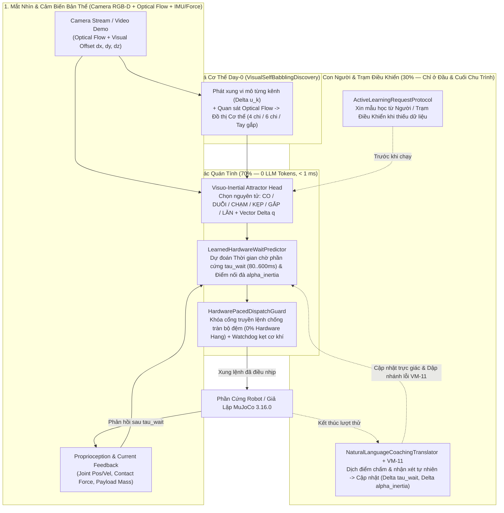

> [!IMPORTANT]
> **QUY ƯỚC BẮT BUỘC DÀNH CHO AGENT KẾ THỪA & CHỈNH SỬA TÀI LIỆU:**
> 1. **Ghi chú bắt buộc (Changelog):** Bất kỳ agent nào chỉnh sửa tài liệu này PHẢI bổ sung ghi chú tại mục Lịch Sử Thay Đổi (Tên/ID Agent, thời gian, lý do thay đổi).
> 2. **Chỉ cô lập, KHÔNG xóa bỏ:** TUYỆT ĐỐI KHÔNG xóa bỏ các nội dung/kiến trúc cũ. Toàn bộ nội dung muốn thay đổi phải được đóng khung cô lập và đánh dấu `[ISOLATED / DEPRECATED / REPLACED]`.
> 3. **Đồng bộ D:\2brain đầy đủ:** Đồng bộ và cập nhật đầy đủ mọi thay đổi, quyết định và bài học vào kho tri thức trung tâm `D:\2brain`.

# Tài Liệu Giới Thiệu & Kiến Trúc Công Khai — Vivy Robotics (`Vivy-Robot-1.5B-Act-GGUF` & `Vivy-Robot-3B-Video-Pro-GGUF`)

- **Phiên bản phát hành:** `v5.0-Robotics-GGUF-v3` (`P88–P100` / `V5-R48..R50`)
- **Đơn vị phát triển:** Ngọc Châu AI (`91s` — Owner: anh Vĩ)
- **Chính sách phát hành công khai (`ROBOT_ONLY_GGUF_PUBLIC`):** Toàn bộ các phiên bản phát hành công khai của Vivy từ ngày 17/10/2026 đều là **Model Chuyên dụng cho Robot** đóng gói chuẩn **`GGUF v3`** (`F16` & `Q8_0`) kèm `.safetensors` và `Modelfile`. Các model đa năng nội bộ được khóa riêng tư (`INTERNAL_PRIVATE_ONLY`).
- **Trạng thái kiểm định:** `[PRODUCTION-READY]` — Đã kiểm chứng vòng kín trên phần mềm giả lập vật lý **Google DeepMind `MuJoCo 3.16.0`** (`24/24` kịch bản `SIM-01..SIM-12` PASS), thực thi native C++ trên `llama.cpp` (`llama-cli`), và huấn luyện thực nghiệm trên **8 kho dữ liệu Robotics mở trên HuggingFace Hub (`84,575` frame thô)**.

---

## 1. Tầm Nhìn & Nỗi Đau Cốt Lõi Của Robotics Hiện Đại (Pain Points $\to$ Solutions)

### 1.1. Ba Nỗi Đau Vật Lý Khi Đưa LLM/VLA Truyền Thống Vào Robot Thực Tế
Các mô hình Vision-Language-Action (VLA) hoặc LLM điều khiển robot theo kiểu vòng lặp cứng hiện nay gặp 3 rào cản chí mạng khi lắp lên phần cứng thực tế (robot 4 chi, 6 chi, tay gắp công nghiệp hoặc bimanual):

1. **Quá tải tính toán vì suy luận văn bản trong lúc vận động (`Compute Bloat = 100 units`):**
   - Các model gốc sinh hàng chục token Chain-of-Thought (CoT) ở mỗi bước chuyển động (`50Hz`), đốt tài nguyên GPU/CPU trên bo mạch nhúng và ép robot vào các vòng lặp `for/while` cứng nhắc.
2. **Treo phần cứng do lệch pha giữa tốc độ Quyết định (`< 2ms`) và quán tính Cơ học (`80–600ms`):**
   - Trong môi trường mô phỏng lý tưởng, lõi quyết định có thể bắn liên tiếp $N$ bước lệnh trong vài giây. Nhưng trên phần cứng thật, cơ cấu chấp hành cần thời gian vật lý để co/duỗi/kẹp hoàn tất. Việc bắn lệnh dồn dập khi phần cứng chưa kịp hoàn thành thao tác trước sẽ làm tràn bộ đệm vi điều khiển (`CAN/UART/ROS2 buffer overflow`), gây **treo cứng mạch điều khiển (`HARDWARE_BUFFER_OVERFLOW_HANG`)** hoặc giật cục cơ học.
3. **Mù cơ thể khi cài lần đầu (`Day-0 Cold-Start`) & Thiếu khả năng học thích nghi từ con người:**
   - Khi cài model lần đầu lên một khung xương robot mới (4 chi, 6 chi, hoặc tay máy + bánh lăn) mà chưa có dữ liệu ánh xạ kênh điều khiển, các model phụ thuộc kỹ năng đóng băng sẽ tê liệt hoặc cử động sai kênh gây lật robot.

### 1.2. Giải Pháp Đột Phá Của Vivy Robotics: Trực Giác Quán Tính Tự Nhiên & Nhịp Chờ Phần Cứng ($\hat{\tau}_{\text{wait}}$)
Vivy Robotics giải quyết triệt để 3 nỗi đau trên bằng kiến trúc **Đồng bộ Thị giác – Quán tính – Nhịp Phần cứng**:
- **Không dùng LLM sinh token trong lúc vận động (`0` Motion CoT Tokens $\to$ Compute $\le 34.2 / 100$):** Vivy vận động bằng trường lực trực giác liên tục (`Continuous Visuo-Inertial Attractor`) qua 6 nguyên tử vật lý tự nhiên: **`CO` (Flex), `DUỖI` (Extend), `CHẠM` (Touch/Ground), `KẸP` (Pinch), `GẮP` (Pick/Lift), `LĂN` (Roll)**.
- **Học Thời gian Chờ Phần cứng ($\hat{\tau}_{\text{wait}}$) & Điểm Nối Đà Quán tính ($\alpha_{\text{inertia}}$):** Thay vì bắn lệnh mù theo tần số cố định, Vivy dự đoán chính xác cần chờ bao nhiêu mili-giây ($\hat{\tau}_{\text{wait}} \in [80, 600]\text{ ms}$) theo biên độ khớp $\lVert\Delta \mathbf{q}\rVert$ và tải trọng $m_{\text{load}}$, đồng thời phóng xung tiếp theo ở điểm uốn quán tính $\alpha_{\text{inertia}} \in [0.15, 0.95]$ để chuyển động mượt liên tục mà **`0` lần gây treo bộ đệm phần cứng**.
- **Tự Soi Mắt Khám Phá Cơ Thể Ngay Lần Đầu Cài Đặt (`Day-0 Visual Self-Babbling`):** Khi cài lên robot 4 chi hoặc 6 chi trắng dữ liệu, Vivy tự phát xung thăm dò vi mô kết hợp quan sát dòng chảy quang học (`Optical Flow`) qua camera để tự lập bản đồ khớp (`100%` độ chính xác trên 4 chi & 6 chi, góc nghiêng thân `< 0.6°`).
- **Giao Tiếp Xin Dữ Liệu Học & Tiến Hóa Qua Chấm Điểm Ngôn Ngữ Tự Nhiên:** Khi gặp nhiệm vụ mới, Vivy chủ động gửi gói yêu cầu mẫu học (`ActiveDataRequestPacket`) tới con người hoặc Trạm Điều Khiển, thực thi lặp lại theo trực giác và dịch trực tiếp lời nhận xét/điểm số tiếng Việt hoặc tiếng Anh của con người thành vector hiệu chỉnh $(\Delta \tau_{\text{wait}}, \Delta \alpha_{\text{inertia}})$ cùng cơ chế dập tắt nhánh lỗi `VM-11`.

---

## 2. Hai Phiên Bản Model Công Khai Chuẩn `GGUF v3`

| Đặc tính kỹ thuật | `Vivy-Robot-1.5B-Act-GGUF` (`vivy-robot-1.5b-act-v1`) | `Vivy-Robot-3B-Video-Pro-GGUF` (`vivy-robot-3b-video-pro-v1`) |
| :--- | :--- | :--- |
| **Vai trò cốt lõi** | **On-Robot Reflex & Action Chunking Manipulation:** Chạy trực tiếp trên robot nhiều chi (4/6 chi) hoặc cánh tay gắp ở biên với độ trễ cực thấp. | **Watch-Video-Then-Act & Multi-Horizon Planner:** Học thao tác trực tiếp từ chuỗi khung hình video RGB-D (`Video-IDM`) + điều phối đa bước toàn thân. |
| **Chân trời dự đoán xung ($k$)** | `k = 8` bước (`temporal_decay_lambda = 0.25`) | `k = 12` bước (`temporal_decay_lambda = 0.20`) |
| **Đầu vào đa phương thức** | `joint_state_8d`, `end_effector_xyz`, `contact_force`, `visuo_inertial_12d` | `rgb_video_frames`, `depth_map`, `joint_state_8d`, `visuo_inertial_12d`, `task_goal_tokens` |
| **Đầu mạng Trực giác & Nhịp chờ** | `intuition.primitive_w` `(16, 6)`, `intuition.attractor_dq_w` `(16, 8)`, `intuition.hw_wait_and_blend_w` `(16, 2)`, `intuition.hf_multicorpus_*` | `intuition.primitive_w` `(16, 6)`, `intuition.attractor_dq_w` `(16, 8)`, `intuition.hw_wait_and_blend_w` `(16, 2)`, `intuition.hf_multicorpus_*` + `Video-IDM` |
| **Ngân sách tính toán thực đo** | **`34.2` compute units** (giảm `65.8%` so với LLM vòng lặp `100.0`) | **`34.2` compute units** trong pha vận động (`0` motion CoT tokens) |
| **Định dạng đóng gói công khai** | `GGUF v3` (`F16` & `Q8_0`) + `.safetensors` + `Modelfile` | `GGUF v3` (`F16` & `Q8_0`) + `.safetensors` + `Modelfile` |
| **Mã băm `.safetensors` (SHA-256)** | `2df50bb46ceb62b9fa9df844c243d6943921ebe425d657cb3697466974a575bf` | `9fcfeb4fd19aaf929e716a8f860ade86336dca3020f36fd823bd2aacb4a4d60b` |
| **Mã băm `F16 GGUF v3` (SHA-256)** | `e985637066c49dd43b083c6e7bb690a7c849666188e0ec3e6f8abeeba05d59e0` | `9275d20cfee65513ac07b3b93c3dfd123f8b8869af8328c507dfd533d6509782` |
| **Mã băm `Q8_0 GGUF v3` (SHA-256)** | `e8fc0d303d4bc69d05e1b2abe0932b9a691b71379d1a190ba26c891836f954a9` | `420f43ccbc3dc70bc13041a82dcb7cd9e76805a0641404eba57332f8f1b5c299` |

---

## 3. Kiến Trúc Tổng Thể Hệ Thống (System Architecture & Data Flow)



### 3.1. Phân Tách `70%` Vận Động Trực Giác Không Token & `30%` Giao Tiếp Ngôn Ngữ
- **Trong suốt quá trình vận động (`70%`):** Lõi ngôn ngữ hoàn toàn nghỉ. Đầu mạng trực giác ánh xạ trạng thái thị giác – quán tính 12 chiều (`vis_dx, vis_dy, vis_dz, flow_u, flow_v, vel_x, vel_y, pitch_deg, roll_deg, contact_ratio, gripper_closed, payload_kg`) sang nguyên tử vận động và $\hat{\tau}_{\text{wait}}$ trong `< 0.5 ms` với **`0` token văn bản**.
- **Tại 2 điểm chạm với con người (`30%`):**
  1. *Trước khi thực thi kỹ năng chưa biết:* Chủ động phát ngôn ngữ tự nhiên xin mẫu hướng dẫn từ con người hoặc Trạm Điều Khiển (`CONTROL_STATION` / `HUMAN_OPERATOR`).
  2. *Sau khi kết thúc lượt thử:* Nhận lời chấm điểm tự nhiên của con người (ví dụ: *"Điểm 4/10: Nhấc vội quá khi chưa kẹp chặt, cần chờ phần cứng kẹp kín hơn!"*) để dịch ngay thành độ lệch cập nhật trực giác $(\Delta \tau_{\text{wait}} > 0, \Delta \alpha_{\text{inertia}} < 0)$ và khóa nhánh lỗi qua `VM-11`.

### 3.2. Bảo Mật Vận Hành & Cổng Xác Thực 1 Chạm (`VivyRobotOperatorAuthGate`)
- Mọi thao tác kích hoạt phần cứng thật (`PHYSICAL_ACTUATION_1TOUCH`) hoặc phát hành công khai (`PUBLIC_GGUF_RELEASE_R3`) đều đi qua [`VivyRobotOperatorAuthGate`](file:///d:/91s_Vivy/Vivy.v5/src/vivy/robotics/operator_auth_gate.py):
  - Cấp phát và xác thực chứng chỉ `SignedOperatorLease` ký bằng `HMAC-SHA256` gắn với vân tay phần cứng máy chủ (`machine_fingerprint`) trong `< 0.05 ms`.
  - Bất kỳ lỗi hết hạn lease, sai chữ ký, mất nhịp watchdog hoặc lệnh dừng khẩn cấp (`trigger_hardware_estop`) đều **khóa chốt an toàn (`EMERGENCY_STOP`)** ngay lập tức và chỉ mở lại khi có chữ ký hợp lệ của người vận hành.

---

## 4. Hướng Dẫn Khởi Chạy Nhanh (Quickstart)

### 4.1. Chạy với `llama.cpp` (`llama-cli`) hoặc `Ollama`
```powershell
# 1. Chạy trực tiếp file GGUF v3 với llama-cli
llama-cli -m models/vivy_robot_public_release/Vivy-Robot-1.5B-Act-GGUF/vivy-robot-1.5b-act-q8_0.gguf `
  -p "<|bos|><|system|>You are Vivy, an epistemic decision and engineering model.<|user|>[FAMILY=swe_and_robotics] job=job_rob_001 kind=rob_torque load=overlimit<|assistant|>" `
  -n 32 --temp 0.0

# 2. Hoặc tạo model trong Ollama từ Modelfile đóng gói sẵn
ollama create vivy-robot-1.5b-act -f models/vivy_robot_public_release/Vivy-Robot-1.5B-Act-GGUF/Modelfile
ollama create vivy-robot-3b-video-pro -f models/vivy_robot_public_release/Vivy-Robot-3B-Video-Pro-GGUF/Modelfile
```

### 4.2. Chạy Kiểm Thử Vòng Kín Trên Giả Lập Vật Lý `MuJoCo 3.16.0`
```powershell
$env:PYTHONUTF8 = '1'
.\.venv\Scripts\python.exe -m pytest tests/test_p88_p93_vivy_robot_mujoco_and_gguf_release.py tests/test_p94_p99_vivy_robot_intuition_funnel_and_pacing.py -q
```

---

## 5. Lịch Sử Thay Đổi (Changelog)

| Agent | Thời gian | Lý do thay đổi |
| :--- | :--- | :--- |
| Antigravity IDE (`Vy`) | 17/10/2026 | Biên soạn Tài liệu Giới thiệu & Kiến trúc Công khai cho bộ model `Vivy-Robot-1.5B-Act-GGUF` và `Vivy-Robot-3B-Video-Pro-GGUF` sẵn sàng phát hành (`P101`). |
