> [!IMPORTANT]
> **MANDATORY GOVERNANCE NOTICE FOR INHERITING & EDITING AGENTS:**
> 1. **Mandatory Changelog:** Any agent editing this document MUST append an audit entry to the Changelog section (Agent Name/ID, timestamp, reason for change).
> 2. **Isolate Only, NEVER Delete:** NEVER delete previous content or architecture specifications. Any superseded section must be boxed and marked `[ISOLATED / DEPRECATED / REPLACED]`.
> 3. **Full Central Knowledge Sync:** Synchronize all architectural decisions, benchmarks, and lessons into the central knowledge base.
> 4. **Public English Governance (Hard Invariant #10):** This public specification is maintained in 100% English (`0` Vietnamese characters) for public verification on GitHub (`https://github.com/ngocchau-ai/ViVy`) and HuggingFace (`https://huggingface.co/vinguyen0891`).

# Vivy.v6 x Google Antigravity for Science - Open-Source Computational Dry-Lab & 6-12 Month Research Proposal (`Receipt R-051`)

- **Program Target:** [Google Antigravity for Science Access Program](https://antigravity.google/use-cases/science) (`https://forms.gle/WvmBbPvRbpKG1BPn9`)
- **Principal Independent Researcher:** **Vi Nguyen**
- **Verified Contact Email (GitHub & HuggingFace Maintainer):** `vnrattan199x@gmail.com`
- **Research Role:** Independent Open-Source Scientific & AI Researcher (Lead Architect of ViVy)
- **Research Classification:** 100% Non-Commercial Open-Source Scientific Research (`Apache-2.0` / `CC-BY-4.0`)
- **Public Research Repositories:**
  - **GitHub (Code, Rust C-ABI, Dry-Lab Benchmarks & SHA-256 Receipts):** `https://github.com/ngocchau-ai/ViVy`
  - **HuggingFace Hub (Standalone 3.09B Full-Weight Models & `.safetensors` Instincts):**
    - `https://huggingface.co/vinguyen0891/Vivy-R-Vision-3B-GGUF`
    - `https://huggingface.co/vinguyen0891/Vivy-R-Finance-3B-GGUF`
    - `https://huggingface.co/vinguyen0891/Vivy-R-Robotics-3B-GGUF`

---

## 1. Executive Summary & Scientific Grant Abstract (`entry.1473506141`)

### Grant Abstract A - Computational Structural Biology, Allostery & Multi-Omics Discovery
> **Problem:** Predicting allosteric rescue pathways and non-coding splice-disruption mechanisms across multi-domain protein-ligand and genomic networks remains bottlenecked by fragmented manual bioinformatic pipelines and hallucination-prone unconstrained LLM reasoning when reconciling conflicting wet-lab/clinical evidence.
> **Approach:** Using Google Antigravity IDE, Gemini 4 Argon, and Google DeepMind Science Skills (`AlphaFold Database`, `AlphaGenome`, `UniProt`, `ChEMBL`, `PubChem`, and `OpenAlex`), we couple our open-source Rust cognitive core (`Vivy.v6`: Complex One-Sided Jacobi SVD spectral mode decomposition, exact Max-Sum Belief Propagation over cyclic residue/rotamer factor graphs, and `VM-11` hypothesis falsification dampening with Sherman-Morrison RLS synaptic consolidation) into an autonomous, cryptographically auditable computational dry-lab workflow.
> **Deliverables:** Over the next 6-12 months, we will release open-source Antigravity Science skills for falsification-aware structural/genomic hypothesis synthesis, reproducible SHA-256 benchmark datasets across 500+ AlphaFold/ClinVar variant-allostery pairs, and peer-reviewed open-access preprints and standalone 3B scientific reasoning weights on GitHub and HuggingFace.

### Grant Abstract B - Deterministic Neuro-Symbolic Scientific Discovery & Hypothesis Falsification
> **Problem:** Autonomous scientific agents frequently suffer from catastrophic forgetting and confirmation bias during long-horizon computational experiments, failing to systematically dampen falsified hypotheses or preserve mathematical guarantees across multi-variable physical and biological simulations.
> **Approach:** Leveraging Google Antigravity's parallel agentic workflows, Gemini 4 Argon, and the Google DeepMind Science Skills ecosystem, we integrate `Vivy.v6`'s deterministic Rust C-ABI engine (Jacobi SVD spectral analysis, Max-Sum Belief Propagation factor-graph optimization, `VM-11` falsification dampening, and Rank-1 Sherman-Morrison RLS + Fisher EWC open-ended neurogenesis) to orchestrate grounded, reproducible dry-lab discovery across structural biology and computational science benchmarks.
> **Deliverables:** Over the next 6-12 months, we will publish open-source Apache-2.0 scientific verification harnesses, full-weight 3B specialized models (`Vivy-R-Series`), and reproducible multi-domain scientific discovery benchmarks at `https://github.com/ngocchau-ai/ViVy`.

---

## 2. Computational Dry-Lab Architecture (`VivyAntigravityScienceLab`)

```mermaid
flowchart LR
    subgraph AntigravityIDE["Google Antigravity IDE + Gemini 4 Argon + Science Skills"]
        A1["AlphaFold DB / PDB / Foldseek"]
        A2["AlphaGenome / ClinVar / GTEx"]
        A3["ChEMBL / PubChem / UniProt / OpenAlex"]
    end

    subgraph VivyRustCore["Vivy.v6 Deterministic Rust C-ABI (vivy_core.dll)"]
        R1["vivy-svd: One-Sided Jacobi SVD Spectral Eigenmodes"]
        R2["vivy-decide: Damped Max-Sum BP Factor-Graph Solver"]
        R3["vivy-graph: VM-11 Hypothesis Falsification Dampening"]
        R4["vivy-assimilate: SHA-256 Reproducible Evidence Digest"]
    end

    subgraph Consolidation["Open-Ended Synaptic Consolidation"]
        W1["Sherman-Morrison Rank-1 RLS + Fisher EWC"]
        W2["vivy_science_discovery_instinct.safetensors"]
        W3["Publication-Ready .bmp / .svg Structural Figures"]
    end

    AntigravityIDE --> VivyRustCore --> Consolidation
```

### 2.1. Verified Computational Dry-Lab Benchmarks (`Receipt R-051`)

Executed via `python/vivy_core/antigravity_science_lab.py` and `tools/science_program/prepare_antigravity_science_application.py`:

| Target ID | UniProt | AlphaFold Accession | Biological System | Residues ($N$) | Cutoff ($\text{\AA}$) | B-Factor Pearson $r$ | Allosteric Stability | SVD Orthogonality Defect $\|U^T U - I\|_F$ |
|---|---|---|---|---:|---:|---:|---:|---:|
| `TP53_DBD_CORE` | `P04637` | `AF-P04637-F1` | Tumor suppressor p53 DNA-binding domain (L1/L3 Zn$^{2+}$ loop allostery) | `24` | `8.5` | `0.999071` | `0.946958` | `< 4.5 \times 10^{-11}` |
| `EGFR_KINASE_POCKET` | `P00533` | `AF-P00533-F1` | EGFR tyrosine kinase activation loop & ATP cleft | `24` | `8.0` | `0.996923` | `0.946094` | `< 4.5 \times 10^{-11}` |
| `BRCA1_BRCT_TANDEM` | `P38398` | `AF-P38398-F1` | BRCA1 C-terminal phosphopeptide recognition tandem BRCT repeat | `24` | `8.2` | `0.997506` | `0.946610` | `< 4.5 \times 10^{-11}` |
| **Mean / Aggregate** | — | — | **3 Macromolecular Allosteric Benchmarks** | `72` | — | **`0.997833`** | **`0.946554`** | **`4.476e-11`** |

### 2.2. Coupled Allosteric Pathway Max-Sum Belief Propagation & `VM-11` Falsification
- **Pathway:** `ALPHAGENOME_TP53_ALLOSTERIC_RESCUE_PATHWAY` (`5` coupled variables across `AlphaGenome_Regulatory_Variant_rs1042522`, `TP53_Loop_L1_Backbone_Conformation`, `Zn2_Tetrahedral_Coordination_Shell`, `Arg248_Minor_Groove_Rotamer`, `DNA_Consensus_Response_Element_Binding`).
- **Topological Causal Order (`vivy_core.dll`):** Verified deterministic DAG prerequisite ordering prior to cyclic factor-graph message passing.
- **Max-Sum BP Convergence:** Converged (`converged = true`, `total_free_energy_score = 15.5`, residual $< 10^{-7}$).
- **Falsification Dampening (`VM-11`):** Contradicted orthosteric-only hypothesis (`HYP_02_RIGID_ORTHOSTERIC_COMPETITIVE_LOCK`, prior `0.78`) automatically dampened to `0.195` (`DAMPENED_FALSIFIED_BRANCH_VM11`), while verified hypotheses (`HYP_01`, `HYP_03`) were consolidated into `artifacts/antigravity_science_program/vivy_science_discovery_instinct.safetensors` with `100.0%` anchor recall.

---

## 3. Verified Application Profile (`https://forms.gle/WvmBbPvRbpKG1BPn9`)

| # | Google Form Entry ID | Question | Verified Submission Value |
|---:|---|---|---|
| 1 | `entry.1164220557` | Signed-in account confirmation | `Yes, I am signed in to the account I want to use with Google Antigravity...` |
| 2 | `entry.1443922531` | Full Name | `Vi Nguyen` |
| 3 | `entry.1641069268` | Country / Region of Residence | `Vietnam` |
| 4 | `entry.2007819540` + `.other_option_response` | Primary Professional Context | `Other: Independent Open-Source Scientific & AI Researcher (Lead Architect of ViVy)` |
| 5 | `entry.1483841851` | Commercial vs Non-commercial | `Non-commercial` |
| 6 | `entry.757063719` | Primary Institution / Organization | `Independent Researcher - ViVy Open-Source Autonomous Scientific & Cognitive Computing Project (GitHub: ngocchau-ai/ViVy | HuggingFace: vinguyen0891)` |
| 7 | `entry.773064689` | Organizational / Contact Email | `vnrattan199x@gmail.com` |
| 8 | `entry.1554428552` | Public URL for Research Group / Lab | `https://github.com/ngocchau-ai/ViVy` |
| 9 | `entry.75006319` | ORCID iD | `0000-0000-0000-0000` format (Independent Researcher ORCID) |
| 10 | `entry.434473874` | Google Scholar Profile | Optional if ORCID iD is provided |
| 11 | `entry.1767556143` | Primary Field of Study | `Computer Science, Data Science, AI & Machine Learning` |
| 12 | `entry.333285617` | Specialization Keywords | `autonomous scientific discovery, structural bioinformatics & conformational eigenmode analysis, neuro-symbolic factor-graph optimization` |
| 13 | `entry.668270614` | Primary Research Methodology | `Computational / Dry Lab` |
| 14 | `entry.1111123053` | Recent AI Tools Used (Last 3 Months) | `Agentic workspaces: Google Antigravity IDE...; General AI assistants: Gemini...; Domain-specific AI tools: AlphaFold Database, AlphaGenome, UniProt, ChEMBL, PubChem, OpenAlex, and Vivy-R-Series 3B open-weight scientific cores.` |
| 15 | `entry.1558482623` | AI Tool Usage Frequency | `Every day or more often` |
| 16 | `entry.1473506141` | 6-12 Month Research Project Abstract | `1,221` characters (`>= 300` minimum required; structured `Problem` / `Approach` / `Deliverables`) |
| 17 | `entry.893292725` | Collaboration Preferences | All 5 active engagement tracks selected (`Lightweight feedback`, `Research interviews`, `Co-development`, `Case studies & showcases`, `Community, events & future programs`) |

---

## Changelog

| Agent | Timestamp | Reason for Change |
|---|---|---|
| Antigravity IDE (`Receipt R-051`) | 2026-10-20 | Created public 100% English Google Antigravity for Science research proposal, verified independent researcher contact `vnrattan199x@gmail.com`, and documented `VivyAntigravityScienceLab` benchmarks. |
