> [!IMPORTANT]
> **QUY ƯỚC BẮT BUỘC DÀNH CHO AGENT KẾ THỪA & CHỈNH SỬA TÀI LIỆU:**
> 1. **Ghi chú bắt buộc (Changelog):** Bất kỳ agent nào chỉnh sửa tài liệu này PHẢI bổ sung ghi chú tại mục Lịch Sử Thay Đổi (Tên/ID Agent, thời gian, lý do thay đổi).
> 2. **Chỉ cô lập, KHÔNG xóa bỏ:** TUYỆT ĐỐI KHÔNG xóa bỏ các nội dung/kiến trúc cũ. Toàn bộ nội dung muốn thay đổi phải được đóng khung cô lập và đánh dấu `[ISOLATED / DEPRECATED / REPLACED]`.
> 3. **Đồng bộ D:\2brain đầy đủ:** Đồng bộ và cập nhật đầy đủ mọi thay đổi, quyết định và bài học vào kho tri thức trung tâm `D:\2brain`.

# Quy Trình Huấn Luyện, Phễu Lọc Dữ Liệu Trực Giác 4 Tầng & Đóng Gói `GGUF v3` — Vivy Robotics (`P88–P100`)

- **Phiên bản:** `v5.0-Robotics-Training-Spec` (`V5-R48..R50`)
- **Áp dụng cho:** `Vivy-Robot-1.5B-Act-GGUF` (`vivy-robot-1.5b-act-v1`) & `Vivy-Robot-3B-Video-Pro-GGUF` (`vivy-robot-3b-video-pro-v1`)
- **Bất biến dữ liệu (`D-7`):** Toàn bộ tập dữ liệu huấn luyện, kiểm định (`dev`) và thi kín (`sealed_test`) bắt buộc sinh và lưu **ngoài thư mục repo** (`~/.vivy_heldout_exams/*`), kiểm chứng `0` giao cắt nhóm (`zero_group_overlap_verified = True`) và `0` nhãn bịa (`test_no_fabricated_labels.py`).

---

## 1. Tổng Quan Quy Trình Huấn Luyện 3 Giai Đoạn

```mermaid
flowchart LR
    subgraph StageA["Giai đoạn 1: Học Thao Tác & Xem Video (P88–P93)"]
        D1["Quỹ đạo MuJoCo 3.16.0 ngoài repo\n~/.vivy_heldout_exams/robotics_sim_p89/\n(train=888, dev=296, test=296)"]
        ACT["Huấn luyện Action Chunking (k=8/12)\n+ Temporal Ensembling + Video-IDM"]
    end

    subgraph StageB["Giai đoạn 2: Phễu Lọc 4 Tầng & Nhịp Phần Cứng (P94–P99)"]
        F4["Phễu lọc 4 tầng VivyIntuitiveDataFunnel\nCắt 266,112 token CoT, nén 8.8x\n~/.vivy_heldout_exams/robotics_intuition_p94/"]
        INT["Huấn luyện 3 Đầu Mạng Trực Giác & Nhịp Chờ\n(CO/DUỖI/CHẠM/KẸP/GẮP/LĂN + tau_wait + alpha_inertia)"]
    end

    subgraph StageC["Giai đoạn 3: Huấn Luyện Bổ Sung 8 Kho Thực Tế HF Hub (P100)"]
        HF8["8 Kho Parquet Mở trên HuggingFace Hub\n(84,575 frame thô -> 1,457 xung trực giác)\n~/.vivy_heldout_exams/robotics_real_hf_corpora_p100/"]
        COLAB["Huấn luyện Liên tục trên Google Colab\nqua googlecolab/colab-mcp (160 epochs)"]
        GGUF["Xuất .safetensors + Đóng gói GGUF v3\n(F16 & Q8_0) + Kiểm định llama-cli & MuJoCo"]
    end

    D1 --> ACT --> F4 --> INT --> HF8 --> COLAB --> GGUF
```



---

## 2. Cơ Chế Phễu Lọc Dữ Liệu Trực Giác 4 Tầng (`VivyIntuitiveDataFunnel`)

Để biến các bộ dữ liệu quỹ đạo mở ngoài cộng đồng (vốn được thu thập ở tần số dày `15Hz–50Hz` hoặc kèm văn bản suy luận rườm rà của các model VLA/LLM gốc) thành dữ liệu trực giác tự nhiên phù hợp với Vivy, mọi tập dữ liệu đều phải đi qua 4 tầng lọc trong [`src/vivy/robotics/intuitive_data_funnel.py`](file:///d:/91s_Vivy/Vivy.v5/src/vivy/robotics/intuitive_data_funnel.py):

### Tầng 1: Khử Văn Bản Trong Lúc Vận Động (`De-Verbalization & 70/30 Split`)
- **Quy tắc:** Tách bỏ 100% các chuỗi văn bản suy luận bước-theo-bước (`Chain-of-Thought`) gắn vào giữa các frame chuyển động (`motion_llm_tokens = 0`).
- **Kết quả thực đo (`P94`):** Loại bỏ **`266,112` token văn bản dư thừa** trên `9,504` frame thô, chỉ giữ lại ngôn ngữ tự nhiên ở 2 điểm chạm đầu/cuối chu trình (xin mẫu học & nhận điểm chấm từ con người).

### Tầng 2: Nén Điểm Uốn Quán Tính & Gắn Nhãn Thời Gian Chờ Phần Cứng ($\hat{\tau}_{\text{wait}}, \alpha_{\text{inertia}}$)
- **Quy tắc:** Thay vì học từng vi bước `20ms` (`50Hz`) dễ gây quá tải bộ đệm mạch điều khiển, bộ lọc phát hiện **Điểm uốn quán tính (`Inertial Inflection Points`)** — nơi đạo hàm vận tốc góc hoặc lực tiếp xúc đổi pha ứng với 6 nguyên tử vận động:
  $$\mathcal{A}_{\text{prim}} = \{\text{CO}, \text{DUỖI}, \text{CHẠM}, \text{KẸP}, \text{GẮP}, \text{LĂN}\}$$
- Mỗi xung nguyên tử được gắn nhãn thực nghiệm:
  1. **Vector dịch chuyển khớp đích** $\Delta \mathbf{q} \in \mathbb{R}^8$ (hoặc $\mathbb{R}^6$).
  2. **Thời gian chờ phần cứng hoàn tất ($\tau_{\text{wait}} \in [80, 600]\text{ ms}$):** thời gian thực tế để cơ cấu chấp hành hoàn thành chuyển động dưới tải trọng $m_{\text{load}}$ và độ trễ bám quỹ đạo `|action - observation.state|`.
  3. **Hệ số nối đà quán tính ($\alpha_{\text{inertia}} \in [0.15, 0.95]$):** tỷ lệ phần trăm hành trình mà tại đó xung tiếp theo được phép hòa trộn để cơ thể lướt đi theo quán tính tự nhiên mà không khựng nhịp.
- **Kết quả thực đo:** Tỷ lệ nén quỹ đạo đạt **`8.8x`** (`P94`) và **`58.0x`** trên `84,575` frame thực tế từ 8 kho HuggingFace Hub (`P100`).

### Tầng 3: Chuyển Đổi Vòng Lặp Cứng Thành Trường Lực Trực Giác (`Continuous Attractor Transformation`)
- **Quy tắc:** Xóa bỏ toàn bộ biến đếm bước vòng lặp (`step_idx`, `loop_counter`). Thay bằng ánh xạ trực tiếp từ độ lệch thị giác – quán tính hiện tại sang xung hành động kế tiếp (`rigid_loop_Removed = True`).

### Tầng 4: Cổng Kiểm Định Chống Treo Phần Cứng & Ngân Sách Tính Toán $\le 50\%$ (`Hardware-Pacing & Compute Gate`)
- **Quy tắc:** Chạy thử chuỗi xung qua [`HardwarePacedDispatchGuard`](file:///d:/91s_Vivy/Vivy.v5/src/vivy/robotics/inertial_pacing_and_body_discovery.py) trên giả lập `MuJoCo 3.16.0`:
  - Bác bỏ 100% các tập gây tràn bộ đệm phần cứng (`buffer_overflow_hang_count > 0`) hoặc vượt ngân sách tính toán `50.0` đơn vị (`P94` bác bỏ `18/198` tập lỗi cố ý, giữ lại `180` tập sạch với chi phí tính toán **`34.2 <= 50.0` đơn vị**).

---

## 3. Huấn Luyện Nền Tảng & Huấn Luyện Bổ Sung Đa Kho Tài Nguyên HuggingFace Hub (`P88–P100`)

### 3.1. Huấn Luyện Học Thao Tác (`Action Chunking`) & Học Qua Video (`Video-IDM`) (`P88–P93`)
- **Mã nguồn:** [`src/vivy/robotics/manipulation_and_video_policy.py`](file:///d:/91s_Vivy/Vivy.v5/src/vivy/robotics/manipulation_and_video_policy.py)
- **Tập dữ liệu ngoài repo (`D-7`):** `~/.vivy_heldout_exams/robotics_sim_p89/` (`train = 888`, `dev = 296`, `sealed_test = 296` mẫu, `overlap = 0`).
- **Kết quả hội tụ:**
  - `Vivy-Robot-1.5B-Act-GGUF` ($k=8$, $\lambda=0.25$): `train_action_chunk_mse = 0.011404`, `dev_action_chunk_mse = 0.015524`.
  - `Vivy-Robot-3B-Video-Pro-GGUF` ($k=12$, $\lambda=0.20$ + `Video-IDM` 16-bin Latent Action Tokenizer `<|vid_act_00|>`..`<|vid_act_15|>`): `train_action_chunk_mse = 0.011343`, `dev_action_chunk_mse = 0.015666`.

### 3.2. Huấn Luyện 3 Đầu Mạng Trực Giác Đa Chi & Nhịp Chờ Phần Cứng (`P94–P99`)
- **Mã nguồn:** [`src/vivy/robotics/colab_hf_intuition_trainer.py`](file:///d:/91s_Vivy/Vivy.v5/src/vivy/robotics/colab_hf_intuition_trainer.py)
- **Tập dữ liệu ngoài repo (`D-7`):** `~/.vivy_heldout_exams/robotics_intuition_p94/` (`train = 648`, `dev = 216`, `sealed_test = 216` mẫu trên 3 hình thái `quadruped_4limb`, `hexapod_6limb`, `manipulator_roller`).
- **Kết quả hội tụ:**
  - Local Ridge + Iterative Refinement: `loss` giảm từ **`0.619044` $\to$ `0.011017`**, độ chính xác nguyên tử trên `sealed_test` đạt **`97.69%`**, sai số thời gian chờ phần cứng `tau_wait_mae = 3.459 ms`, sai số nối đà `alpha_inertia_mae = 0.0073`.
  - Live Google Colab (`colab-mcp` `ws://localhost:53560`, `80` epochs PyTorch): `loss` giảm từ **`1.988301` $\to$ `0.000946`**, độ chính xác `sealed_test` đạt **`100.0%`**, `tau_wait_mae = 3.965 ms`.

### 3.3. Huấn Luyện Bổ Sung Liên Tục Trên 8 Kho Dữ Liệu Thực Tế Mở Của HuggingFace Hub (`P100`)
- **Mã nguồn:** [`scripts/run_colab_mcp_robotics_intuition_training.py`](file:///d:/91s_Vivy/Vivy.v5/scripts/run_colab_mcp_robotics_intuition_training.py) & [`src/vivy/robotics/colab_hf_intuition_trainer.py`](file:///d:/91s_Vivy/Vivy.v5/src/vivy/robotics/colab_hf_intuition_trainer.py)
- **8 Kho dữ liệu Parquet thực tế được nạp trực tiếp qua `pyarrow` & `HuggingFace Hub`:**
  1. `lerobot/aloha_sim_transfer_cube_human` (`50Hz`, tay đôi 14-DoF ALOHA): `9,200` frame, `20` eps $\to$ `240` xung.
  2. `lerobot/aloha_sim_insertion_human` (`50Hz`, tay đôi 14-DoF ALOHA lắp ghép): `7,500` frame, `15` eps $\to$ `180` xung.
  3. `lerobot/svla_so100_pickplace` (`30Hz`, cánh tay thực 6-DoF SO-100): `19,631` frame, `25` eps $\to$ `300` xung.
  4. `lerobot/svla_so100_stacking` (`30Hz`, cánh tay thực 6-DoF SO-100): `22,956` frame, `25` eps $\to$ `289` xung.
  5. `lerobot/xarm_lift_medium` (`15Hz`, tay công nghiệp 4-DoF xArm): `20,000` frame, `40` eps $\to$ `160` xung.
  6. `unitreerobotics/G1_Dex1_Stack_Block` (`30Hz`, robot đa chi 29-DoF Unitree G1 + bàn tay khéo léo): `2,770` frame, `6` eps $\to$ `72` xung.
  7. `IPEC-COMMUNITY/droid_lerobot` (`15Hz`, cánh tay thực 8-DoF Franka Panda DROID): `2,095` frame, `8` eps $\to$ `96` xung.
  8. `IPEC-COMMUNITY/bridge_orig_lerobot` (`5Hz`, cánh tay thực 8-DoF WidowX 250 BridgeData v2): `423` frame, `12` eps $\to$ `120` xung.
- **Tập dữ liệu ngoài repo (`D-7`):** `~/.vivy_heldout_exams/robotics_real_hf_corpora_p100/` (`train = 991`, `dev = 244`, `sealed_test = 222` xung, `zero_group_overlap_verified = True`).
- **Kết quả huấn luyện liên tục (`P94 + P100 = 1,639` mẫu train, `160` epochs trên Google Colab):**
  - `continual_loss`: giảm từ **`0.103761` $\to$ `0.015251`**.
  - `real_hf_sealed_test_primitive_acc`: **`100.0%` (`1.0000`)** trên `222` xung thực tế kiểm định kín.
  - `p94_foundation_sealed_test_primitive_acc`: **`97.69%` (`0.9769`)** bảo toàn tri thức đa chi nền tảng.
  - `real_hf_sealed_test_tau_wait_mae_ms`: **`11.1 ms`**, `alpha_inertia_mae`: **`0.0087`**.

---

## 4. Hướng Dẫn Vận Hành Thực Tế Pipeline Huấn Luyện & Đóng Gói `GGUF v3` (Runbook)

### 4.1. Chạy Huấn Luyện & Đồng Bộ 8 Kho Dữ Liệu Thực Tế HuggingFace + Đóng Gói Lại `GGUF v3`
```powershell
$env:PYTHONUTF8 = '1'
.\.venv\Scripts\python.exe scripts/run_colab_mcp_robotics_intuition_training.py --sync-hf-corpora
```

### 4.2. Kết Nối Trực Tiếp Với Phiên Google Colab Đang Mở Qua `googlecolab/colab-mcp`
```powershell
# Bước 1: Khởi chạy WebSocket Bridge Daemon trên cổng ws://localhost:53560 & http://127.0.0.1:18971
$env:PYTHONUTF8 = '1'
.\.venv\Scripts\python.exe scripts/colab_mcp_daemon.py

# Bước 2: Chạy thực thi đẩy cell huấn luyện lên Google Colab và tải về GGUF v3
.\.venv\Scripts\python.exe scripts/run_colab_mcp_robotics_intuition_training.py
```

### 4.3. Danh Mục Tensor Được Đóng Gói Trong `model.safetensors` & `GGUF v3`
Mỗi model công khai (`Vivy-Robot-1.5B-Act-GGUF` và `Vivy-Robot-3B-Video-Pro-GGUF`) chứa:
1. Các tensor điều khiển thao tác & Video-IDM (`act_w1`, `act_b1`, `act_w2`, `act_b2`, `vid_idm_w`, `vid_idm_b`, `safety_envelope`).
2. Các tensor trực giác đa chi & điều nhịp phần cứng nền tảng (`intuition.primitive_w` `(16, 6)`, `intuition.attractor_dq_w` `(16, 8)`, `intuition.hw_wait_and_blend_w` `(16, 2)`, `intuition.predictor_matrix` `(6, 4)`).
3. Các tensor trực giác đa kho thực tế từ 8 bộ dữ liệu HuggingFace Hub (`intuition.hf_multicorpus_primitive_w` `(16, 6)`, `intuition.hf_multicorpus_dq_w` `(16, 6)`, `intuition.hf_multicorpus_wait_w` `(16, 2)`).
4. Toàn bộ 39 tensor backbone `LlamaForCausalLM` kèm 29 thuộc tính KV metadata chuẩn `GGUF v3` (`vivy.robotics.model_id`, `vivy.robotics.tier`, `vivy.robotics.action_chunk_horizon`, `vivy.robotics.temporal_decay_lambda`, `vivy.robotics.quantization`, `vivy.robotics.safetensors_sha256`, `vivy.robotics.release_policy`).

---

## 5. Lịch Sử Thay Đổi (Changelog)

| Agent | Thời gian | Lý do thay đổi |
| :--- | :--- | :--- |
| Antigravity IDE (`Vy`) | 17/10/2026 | Ban hành Tài liệu Quy trình Huấn luyện, Phễu lọc 4 tầng và Đóng gói `GGUF v3` cho Vivy Robotics (`P88–P100` / `P101`). |
